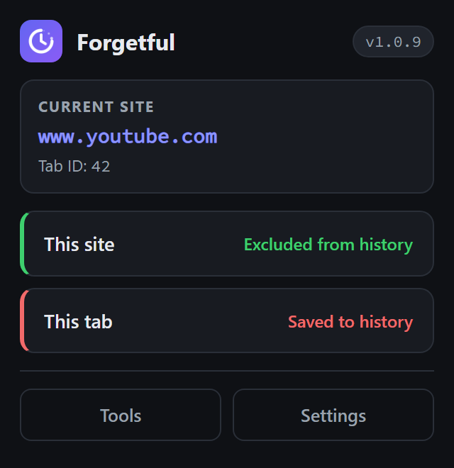
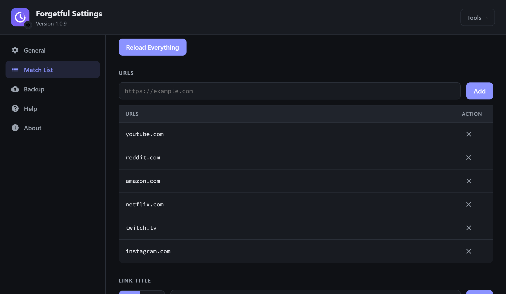
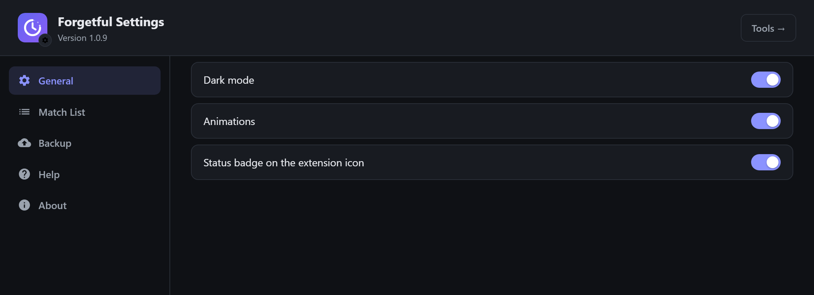
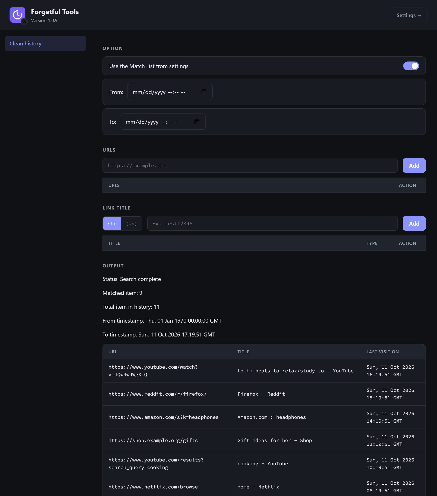

# Forgetful

**Keep chosen sites and tabs out of your browsing history — automatically, without opening a private window.**

Forgetful is a Firefox extension that removes selected pages from your browsing history as you browse. Mark a site once and it never shows up in your history again; mark a tab and everything you open in it stays off the record.

  

  

## Features

- **Per-site rules** — add a site once and every visit to it (including `www.` and any subdomain) is removed from history automatically.
- **Per-tab mode** — mark a tab and all links opened in it are kept out of history (until the tab is closed).
- **Title patterns** — match pages by title, with plain-string or regex patterns.
- **History cleanup tool** — search your existing history by URL, title pattern and date range, then delete the matches in bulk.
- **Firefox Sync** — rules and settings follow your Firefox account across devices and reinstalls (room for thousands of sites).
- **Status badge** — a green ✓ on the toolbar icon means the current page is being kept out of history.
- **Private by design** — no data collection, no external requests. Everything stays on your device or in your Firefox account.
- **Import/export** — full backup as JSON, or just the site list as plain text (one domain per line, easy to edit by hand).

## Screenshots

| Match list | Settings |
| --- | --- |
|  |  |

**History cleanup tool** — find and delete pages that are already in your history:

## Credits

Forgetful is a fork of [NoHistory](https://github.com/sudoker0/NoHistory) by QuanMCPC, used under the MIT License. This fork adds a redesigned UI, Manifest V3 hardening (session-persisted tab marks, sanitized HTML rendering, bundled fonts) and a simplified status badge.

## License

[MIT](LICENSE)
